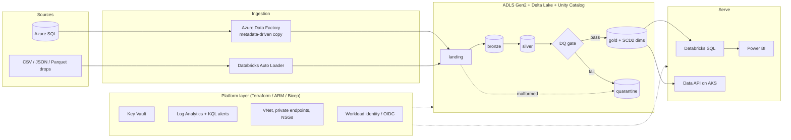
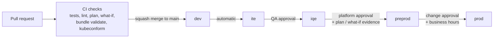

# Azure Automation Portfolio

I'm Tahsin, an Azure DevOps and Data Engineer based in London, working in Azure since 2019, mostly in regulated financial services and consultancy. This repo is a working model of the kind of platform I build: a Databricks lakehouse on Azure, the infrastructure underneath it, and the pipelines that take every change from a pull request to production through five environments (`dev`, `ite`, `iqe`, `preprod`, `prod`).

Everything here runs or validates offline, so you don't need an Azure subscription to try it. It's production-style rather than a copy of any employer's code: names, IDs and IP ranges are placeholders.

[](https://github.com/TahsinKhan7/azure-automation-portfolio/actions/workflows/ci.yml)
[](https://github.com/TahsinKhan7/azure-automation-portfolio/actions/workflows/codeql.yml)
[](LICENSE)


## Where to start

### DevOps and platform engineering

1. [ARM templates](arm-templates/) with linked modules and a parameter file per environment, released through an [ARM-TTK, what-if and approval pipeline](azure-devops-pipelines/arm-validate-deploy.yml) built from [reusable templates](azure-devops-pipelines/templates/).
2. [Terraform](terraform/): 11 modules, five environment roots with identical `main.tf`, OIDC backend auth and [native `terraform test` files](terraform/tests/) against a mocked provider.
3. [Azure Pipelines promotion flow](azure-devops-pipelines/README.md#promotion-flow): one artefact promoted through every environment, approvals on Environments, saved-plan applies and a canary rollout to AKS.
4. [GitHub Actions CI](.github/workflows/ci.yml): path-filtered jobs for each technology, rolled up into one required status.
5. [PowerShell module](powershell/modules/DataPlatform.Automation/) with 25 exported functions behind thin scripts, and [Pester tests](powershell/tests/) that mock every Az cmdlet.

### Data engineering

1. [`dataplatform` package](python/): landing, bronze, silver and gold on Delta Lake, [hash-diff SCD2 in one `MERGE`](python/src/dataplatform/etl/scd2_merge.py), and a [data quality gate](python/src/dataplatform/quality/) driven by [YAML expectation suites](python/config/quality/).
2. [Tests](python/tests/): pytest on a local Delta-enabled Spark session, so every transform is checked against real DataFrames without a workspace.
3. [Notebooks](python/notebooks/): six Databricks notebooks, each a thin wrapper over the package for one pipeline stage.
4. [Databricks Asset Bundle](databricks-bundles/): a multi-task job with the DQ gate between silver and gold, a cluster policy and five targets, plus a [Delta Live Tables](databricks-bundles/src/dlt_claims_pipeline.py) version.
5. [Spark SQL and Unity Catalog](sql/databricks-sql/) (grants, column masks, liquid clustering, KPI views) and a [metadata-driven ADF control schema](sql/azure-sql/metadata_driven_pipeline_config.sql) in T-SQL.

## What's in here

| Capability | Where | How it's checked |
|------------|-------|-------|
| Medallion ETL on Delta Lake with quarantine, SCD2 and DQ gate | [`python/src/dataplatform`](python/src/dataplatform/) | 141 pytest tests pass on a local Spark session (PySpark 3.5, delta-spark 3.2) |
| Databricks job and DLT deployment as code | [`databricks-bundles/`](databricks-bundles/) | One `databricks.yml`, five targets, `bundle validate` job in CI when a workspace is configured |
| Terraform multi-environment platform | [`terraform/`](terraform/) | 11 modules, 5 identical roots, 14 `terraform test` runs with `mock_provider`, tflint and `validate` per directory in CI |
| ARM JSON with a governed release process | [`arm-templates/`](arm-templates/), [`docs/release-management/`](docs/release-management/) | ARM-TTK, static parity checks, `Test-AzResourceGroupDeployment`, what-if with fail-on-delete in preprod/prod |
| Bicep composition with linter enforced at build | [`arm-bicep/`](arm-bicep/) | `bicep build` clean for `main.bicep`, every module and 5 `.bicepparam` files |
| Azure Pipelines promotion with evidence | [`azure-devops-pipelines/`](azure-devops-pipelines/) | 9 pipelines plus reusable templates; plans, what-if and rendered manifests published as run artefacts |
| PowerShell automation done as a tested module | [`powershell/`](powershell/) | 72 Pester tests in 8 files; PSScriptAnalyzer errors fail CI |
| AKS workload with workload identity and Key Vault CSI | [`kubernetes/`](kubernetes/) | kubeconform `-strict` passes across all 5 Kustomize overlays |
| Observability and cost governance in KQL | [`kql-queries/`](kql-queries/) | 6 query files wired to scheduled alerts in `arm-bicep/monitoring-alerts.bicep` |
| Lakehouse and operational SQL | [`sql/`](sql/) | T-SQL control tables and procedures, Spark SQL DDL, grants, KPI views, sqlfluff in CI |
| Supply-chain hygiene | [`scripts/ci/`](scripts/ci/), [`.github/`](.github/) | Pinned tool versions with SHA-256 checks, CodeQL, gitleaks pre-commit |

## Architecture

The platform this code provisions and runs. More detail in [docs/architecture.md](docs/architecture.md).



Every change takes the same route to production, whatever the technology:



## Repo layout

| Folder | What it contains | Files |
|--------|------------------|------:|
| [`arm-templates/`](arm-templates/) | Linked ARM JSON modules, five parameter files, ARM-TTK config, offline parity checks | 15 |
| [`arm-bicep/`](arm-bicep/) | Bicep composition (`main.bicep`), eight resource templates, five `.bicepparam` files, linter config | 16 |
| [`azure-devops-pipelines/`](azure-devops-pipelines/) | Multi-stage YAML for CI, CD, Terraform, ADF, Databricks bundles, AKS, PowerShell and ARM, plus reusable templates | 17 |
| [`databricks-bundles/`](databricks-bundles/) | Databricks Asset Bundle: medallion job, Delta maintenance job, DLT pipeline, cluster policy | 7 |
| [`docs/`](docs/) | Architecture, ADRs and the release-management runbook, environment matrix and release plan template | 11 |
| [`kql-queries/`](kql-queries/) | Log Analytics queries for ADF reliability, Databricks governance, Key Vault hygiene, health and cost | 7 |
| [`kubernetes/`](kubernetes/) | Kustomize base and five overlays for a hardened data API on AKS | 28 |
| [`powershell/`](powershell/) | `DataPlatform.Automation` module, thin operational scripts, ARM tooling, Pester tests | 66 |
| [`python/`](python/) | `dataplatform` package, YAML configuration, notebooks, pytest suite | 57 |
| [`scripts/ci/`](scripts/ci/) | Shell helpers shared by GitHub Actions and Azure Pipelines (pinned, checksum-verified installs) | 5 |
| [`sql/`](sql/) | T-SQL for Azure SQL (metadata, staging, monitoring, maintenance) and Spark SQL for Databricks | 11 |
| [`terraform/`](terraform/) | 11 modules, five environment roots, native tests, tflint config | 95 |
| [`.github/`](.github/) | CI and CodeQL workflows, release drafter, issue and PR templates, security policy | 9 |

## Checks on every change

Defined in [`.github/workflows/ci.yml`](.github/workflows/ci.yml). On pull requests only the areas that changed run; on `main` everything runs. A single `ci-status` job aggregates the results for branch protection.

- **Python package** (`python-tests`): `ruff check`, `ruff format --check`, `pytest` on Java 17 with JUnit output, wheel build.
- **Terraform** (`terraform-lint`, `terraform-validate`): `fmt -check`, `tflint --recursive`, `terraform test`, then `init -backend=false && validate` in a matrix over every module and environment root.
- **Bicep** (`bicep-build`): `az bicep build` for every `.bicep` file and `build-params` for every `.bicepparam`.
- **ARM templates** (`arm-ttk`): JSON lint over the whole repository, then ARM-TTK with a per-template pass/fail summary.
- **PowerShell** (`powershell-quality`): PSScriptAnalyzer (errors fail, warnings reported) and Pester 5 with NUnit results.
- **Kubernetes** (`kubernetes-validate`): `kubectl kustomize` then `kubeconform -strict` for each of the five overlays, rendered manifests uploaded.
- **SQL** (`sql-lint`): sqlfluff with the T-SQL and Spark SQL dialects (advisory).
- **YAML and Markdown** (`yaml-lint`, `markdown-lint`): yamllint blocking, markdownlint advisory.
- **Databricks bundle** (`databricks-bundle-validate`): `databricks bundle validate -t dev`, runs only when a workspace host is configured as a repository variable.
- **CodeQL** ([`codeql.yml`](.github/workflows/codeql.yml)): security-and-quality queries over the Python code, weekly and on change.

## Running it locally

```bash
# Python: tests need Java 17 for the local Spark session
cd python && pip install -e ".[dev]" && ruff check . && pytest -q && cd ..

# Terraform: format, validate every directory, run the native tests
scripts/ci/terraform-validate-all.sh --fmt
terraform -chdir=terraform/tests init -backend=false && terraform -chdir=terraform/tests test

# Bicep
for f in arm-bicep/*.bicep; do bicep build "$f" --stdout > /dev/null; done
for p in arm-bicep/parameters/*.bicepparam; do bicep build-params "$p" --stdout > /dev/null; done

# ARM: offline parity checks and ARM-TTK
python3 arm-templates/tests/check_templates.py
pwsh powershell/arm/Invoke-ArmTtk.ps1 -TemplatePath arm-templates/templates

# PowerShell
pwsh -c "Invoke-ScriptAnalyzer -Path powershell -Recurse -Settings powershell/PSScriptAnalyzerSettings.psd1; Invoke-Pester -Path powershell/tests -CI"

# Kubernetes
for env in dev ite iqe preprod prod; do kubectl kustomize kubernetes/overlays/$env | kubeconform -strict -ignore-missing-schemas -summary; done
```

`pre-commit install` wires the same checks into every commit; see [CONTRIBUTING.md](CONTRIBUTING.md).

## Conventions

- **Naming**: one convention, computed once. `terraform/modules/naming`, `Get-DpResourceName` in PowerShell, the Bicep `main.bicep` variables and the Kubernetes overlays all produce the same names (for example `kv-dp-data-prod-01`), so toolchains cannot drift apart.
- **Five environments**: `dev`, `ite`, `iqe`, `preprod`, `prod`. Environment differences are data (tfvars, bicepparam, bundle variables, Kustomize patches), never divergent code. Private endpoints, GZRS, purge protection and delete locks switch on in `preprod` and `prod`.
- **Trunk-based delivery**: short-lived `feat/`, `fix/` and `chore/` branches, squash merges, `main` always a release candidate, the same artefact promoted through every environment.
- **Conventional Commits** on PR titles and commits; release notes are drafted from them.
- **No secrets in the repository**: workload identity federation for pipelines, Key Vault references in parameters, Secrets Store CSI driver in AKS, gitleaks in pre-commit, placeholder identifiers throughout.

## Contact

Happy to talk through any of it. You can find me on [LinkedIn](https://linkedin.com/in/tahsinkhan4), and the rest of my work is at [github.com/TahsinKhan7](https://github.com/TahsinKhan7).

Licensed under the [MIT licence](LICENSE). For security issues, see [SECURITY.md](.github/SECURITY.md).
