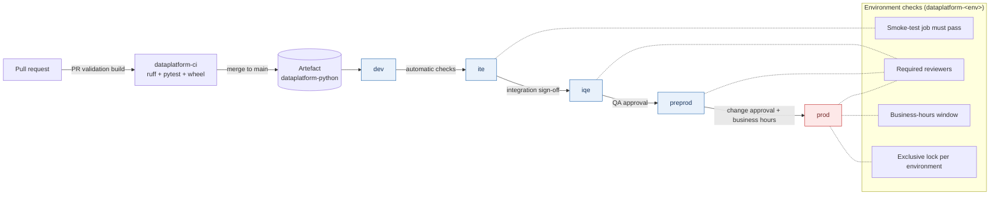
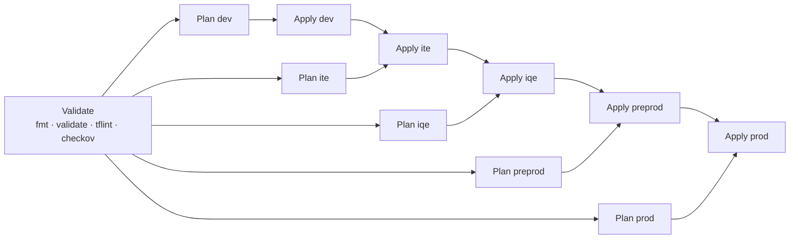

# Azure DevOps pipelines

Multi-stage YAML pipelines that build, validate and promote the data platform
through five environments: **dev -> ite -> iqe -> preprod -> prod**. Every
pipeline follows the same conventions:

- **One template loop, five environments.** Stages are generated with
  `${{ each env in parameters.environments }}` from an object parameter, so the
  promotion path is declared once and an environment is a one-line change.
- **Approvals live on Environments, not in YAML.** Each deployment job targets
  the Azure DevOps Environment `dataplatform-<env>`; approvals, business-hours
  windows and required reviewers are configured there.
- **No secrets in pipelines.** Service connections use workload identity
  federation (OIDC). Terraform uses `ARM_USE_OIDC`, the Databricks CLI uses
  `DATABRICKS_AUTH_TYPE=azure-cli`, and Kubernetes deploys go through the
  Azure Resource Manager connection with `kubelogin`.
- **Pinned, verified tooling.** Third-party binaries are installed by the
  scripts in [`scripts/ci/`](../scripts/ci/) with an exact version and SHA-256.
- **Evidence on every run.** Plans, what-if output, rendered manifests and test
  results are published as artefacts and summarised on the run page.

## Pipelines

| Pipeline | Definition | Trigger | What it does |
|----------|------------|---------|--------------|
| `dataplatform-ci` | [`ci-pipeline.yml`](ci-pipeline.yml) | PR + push to `main` (`python/**`) | Installs Java 17 and the package in `python/`, runs ruff and pytest with coverage, publishes JUnit + Cobertura, builds a wheel and stages notebooks as the `dataplatform-python` artefact. |
| `dataplatform-cd` | [`cd-pipeline.yml`](cd-pipeline.yml) | Successful `dataplatform-ci` on `main` | Promotes the wheel and notebooks to each Databricks workspace (Unity Catalog volume + workspace import) and runs a smoke-test job, one approved stage per environment. |
| `dataplatform-dab` | [`databricks-bundle-deploy.yml`](databricks-bundle-deploy.yml) | PR + push to `main` (`databricks-bundles/**`, `python/**`) | `databricks bundle validate` for every target, then `bundle deploy` (and optionally `bundle run`) target by target. |
| `dataplatform-databricks-redeploy` | [`databricks-deploy.yml`](databricks-deploy.yml) | Manual | Pushes a chosen `dataplatform-ci` build to a single environment: hotfix redeploys and rollbacks. |
| `dataplatform-terraform` | [`terraform-plan-apply.yml`](terraform-plan-apply.yml) | PR + push to `main` (`terraform/**`) | fmt, validate, tflint and checkov; `plan` for every root in parallel with a change summary; `apply` of the saved plan behind approvals, skipped automatically when the plan has no changes. |
| `dataplatform-adf` | [`adf-pipeline-deploy.yml`](adf-pipeline-deploy.yml) | PR + push to `main` (`data-factory/**`) | Validates the factory JSON and exports the ARM template with the ADF utilities, then per environment: what-if, stop triggers, incremental ARM deploy, start triggers and clean-up (`PrePostDeploymentScript.Ver2.ps1`). |
| `dataplatform-powershell` | [`powershell-quality.yml`](powershell-quality.yml) | PR + push to `main` (`powershell/**`) | PSScriptAnalyzer with the repo settings file (errors fail, warnings reported) and Pester 5 with NUnit results and JaCoCo coverage. |
| `dataplatform-aks` | [`kubernetes-deploy.yml`](kubernetes-deploy.yml) | PR + push to `main` (`kubernetes/**`) | Renders every Kustomize overlay, validates with kubeconform, then deploys with `KubernetesManifest@1`: `runOnce` for non-production, 20 % canary with automatic promote/reject for prod. |
| `arm-validate-deploy.yml` and `templates/` | (owned by the ARM/Bicep workstream) | | Reusable stage/job/step templates and the ARM/Bicep deployment pipeline. |

## Promotion flow



The same shape applies to Terraform (`Plan_<env>` in parallel, `Apply_<env>` in
sequence), the Databricks bundle, Data Factory and AKS. A stage only runs for
artefacts built from `main`; a manual run of a feature branch stops after
validation.

### Terraform specifics



- `plan -detailed-exitcode` sets the output variable `hasChanges`; an apply
  stage is skipped when its plan is empty, so a no-op run never asks for approval.
- The apply stage downloads and applies the **saved plan file** reviewed by the
  approver. It never re-plans.
- A plan that destroys resources raises a warning on the run so reviewers see it
  before approving.

## One-time setup

### Service connections (workload identity federation)

One Azure Resource Manager connection per environment, each backed by a
user-assigned managed identity or app registration with a federated credential
for the Azure DevOps issuer. No client secrets.

| Connection | Scope | Roles (least privilege) |
|------------|-------|-------------------------|
| `sc-dataplatform-dev` | dev subscription | Contributor on the platform resource groups, Storage Blob Data Contributor on the state container, Azure Kubernetes Service RBAC Writer on the dev namespace, Databricks workspace admin or SCIM-provisioned service principal |
| `sc-dataplatform-ite`, `sc-dataplatform-iqe`, `sc-dataplatform-preprod` | respective subscriptions | as dev |
| `sc-dataplatform-prod` | prod subscription | as dev, but Azure Kubernetes Service RBAC Writer limited to the platform namespace and Databricks SP restricted to the production catalog |

Inside the pipelines, `AzureCLI@2` with `addSpnToEnvironment: true` exposes
`$servicePrincipalId`, `$tenantId` and the federated `$idToken`, which is all
Terraform (`ARM_USE_OIDC=true`) and the Databricks CLI (`azure-cli` auth) need.

### Variable groups

Variable groups hold **configuration**, never secrets. Anything sensitive comes
from Key Vault-linked groups or is not needed at all thanks to OIDC.

| Group | Used by | Variables |
|-------|---------|-----------|
| `dataplatform-<env>` | cd, databricks-redeploy | `databricksHost`, `wheelVolumePath` (e.g. `/Volumes/dataplatform_<env>/platform/artifacts`), `notebookWorkspaceRoot` (e.g. `/Shared/dataplatform`), `smokeTestJobName` |
| `dataplatform-tf-<env>` | terraform | `tfStateResourceGroup`, `tfStateStorageAccount`, `tfStateContainer` |
| `dataplatform-adf-<env>` | adf | `subscriptionId`, `resourceGroup`, `location`, `adfName`, `adfOverrideParameters` (`-param value ...`) |
| `dataplatform-aks-<env>` | aks | `aksResourceGroup`, `aksClusterName`, `namespace` |

### Environments

Create `dataplatform-dev`, `dataplatform-ite`, `dataplatform-iqe`,
`dataplatform-preprod` and `dataplatform-prod` under **Pipelines > Environments**
and attach checks:

| Environment | Checks |
|-------------|--------|
| `dataplatform-dev` | none (continuous deployment) |
| `dataplatform-ite` | exclusive lock |
| `dataplatform-iqe` | approval by the QA group, exclusive lock |
| `dataplatform-preprod` | approval by platform engineering, exclusive lock |
| `dataplatform-prod` | approval by the change approvers group, business-hours window, exclusive lock, branch control (`refs/heads/main` only) |

### Registering the pipelines

```bash
az pipelines create --name dataplatform-ci \
  --repository azure-automation-portfolio --repository-type tfsgit --branch main \
  --yml-path azure-devops-pipelines/ci-pipeline.yml --skip-first-run
# repeat for cd-pipeline.yml, databricks-bundle-deploy.yml, terraform-plan-apply.yml, ...
```

Add `dataplatform-ci` as a required build on the `main` branch policy so every
pull request gets a validation build.

## Branching strategy

Trunk-based development with short-lived branches:

1. Branch from `main` as `feat/<ticket>-<slug>`, `fix/<ticket>-<slug>` or `chore/<slug>`; branches live for days, not weeks.
2. Open a pull request early. The branch policy requires the `dataplatform-ci` validation build, a reviewer, linked work items and a Conventional Commit title (`feat:`, `fix:`, `ci:`, `docs:` ...).
3. Pull-request builds only validate: `plan`, `what-if`, `bundle validate` and `kustomize | kubeconform` run, nothing is deployed.
4. Squash-merge to `main`. **`main` is always a release candidate**: every merge triggers the CI build and the CD pipelines begin promotion from dev.
5. Progression through ite, iqe, preprod and prod is the same artefact gated by Environment checks; no rebuilds, no environment branches.
6. A production deployment tags the commit `v<major>.<minor>.<patch>`; the GitHub release draft is generated from the Conventional Commit history.
7. Hotfixes follow the same path from `main`. If production must move before the pipeline can catch up, `dataplatform-databricks-redeploy` redeploys a previous known-good build and the fix still goes through a pull request.

## Conventions

- Stage names are `Deploy_<env>`, `Plan_<env>`, `Apply_<env>`; the object parameter's `dependsOn` lists reference those names.
- `condition` always includes `succeeded()` and a `refs/heads/main` check for deployment stages.
- Steps that install tools call `scripts/ci/*.sh`; version bumps are made once, in the script.
- Run summaries (`##vso[task.uploadsummary]`) are written for every plan, what-if and deployment so an approver can review evidence on the run page without opening logs.
