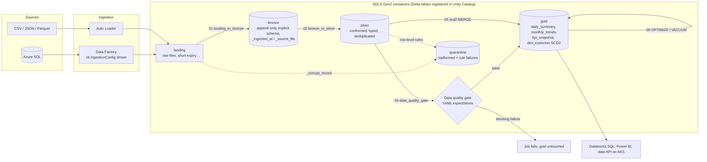
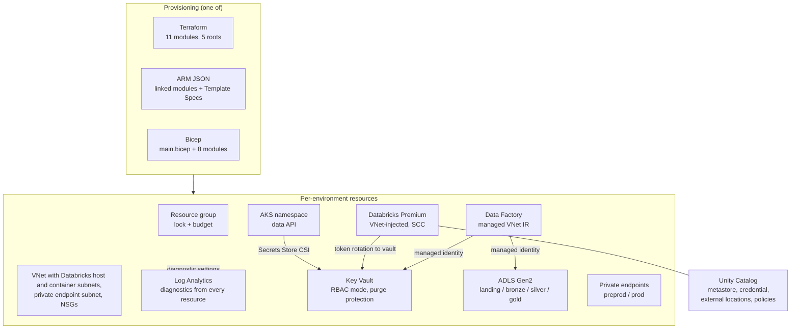

# Architecture

How the pieces in this repository fit together: the lakehouse that processes the data, the platform layer that hosts it, the five environments it is promoted through, and the security, observability and cost controls wrapped around it. Each section points at the code that implements it.

## 1. Lakehouse

| Layer | Contract | Implementation |
|-------|----------|----------------|
| landing | Raw files as delivered; lifecycle expiry 14 to 180 days by environment | ADF copy from the control tables in [`sql/azure-sql/metadata_driven_pipeline_config.sql`](../sql/azure-sql/metadata_driven_pipeline_config.sql); Auto Loader option in [`landing_to_bronze.py`](../python/src/dataplatform/etl/landing_to_bronze.py) |
| bronze | Append-only Delta, explicit DDL per dataset, PERMISSIVE parsing, malformed rows quarantined with their raw text | [`python/config/datasets.yml`](../python/config/datasets.yml), [`etl/landing_to_bronze.py`](../python/src/dataplatform/etl/landing_to_bronze.py), partitioned by ingest date ([`delta_table_ddl.sql`](../sql/databricks-sql/delta_table_ddl.sql)) |
| silver | One row per business key, typed, standardised names, audit columns, liquid clustering on query columns | [`etl/transforms.py`](../python/src/dataplatform/etl/transforms.py), [`etl/bronze_to_silver.py`](../python/src/dataplatform/etl/bronze_to_silver.py) |
| quality gate | Blocking and warning expectations; blocking failures raise `DataQualityError` before gold is written | [`quality/`](../python/src/dataplatform/quality/), suites in [`config/quality/`](../python/config/quality/), mirrored in [`data_quality_queries.sql`](../sql/databricks-sql/data_quality_queries.sql) |
| gold | Aggregates with window functions; SCD Type 2 dimension via hash-diff and one atomic `MERGE` | [`etl/aggregations.py`](../python/src/dataplatform/etl/aggregations.py), [`etl/scd2_merge.py`](../python/src/dataplatform/etl/scd2_merge.py), KPI views in [`gold_kpi_views.sql`](../sql/databricks-sql/gold_kpi_views.sql) |
| maintenance | Weekly OPTIMIZE / ZORDER / VACUUM with a seven-day retention floor and table allow-list | [`databricks/delta_maintenance.py`](../python/src/dataplatform/databricks/delta_maintenance.py), [`delta_maintenance.yml`](../databricks-bundles/resources/jobs/delta_maintenance.yml) |

Orchestration is a single multi-task Databricks job ([`medallion_pipeline.yml`](../databricks-bundles/resources/jobs/medallion_pipeline.yml)) with the DQ task between silver and gold; the task has no retries because a failed expectation is a data problem, not a transient one. A Delta Live Tables pipeline ([`claims_dlt_pipeline.yml`](../databricks-bundles/resources/pipelines/claims_dlt_pipeline.yml)) shows the declarative alternative for the same flow. Governance sits in Unity Catalog: `dataplatform_<env>` catalog, one schema per layer, grants at schema level so analysts never see bronze or quarantine, a column mask for sensitive fields ([`create_unity_catalog_objects.sql`](../sql/databricks-sql/create_unity_catalog_objects.sql), [`terraform/modules/databricks-unity-catalog`](../terraform/modules/databricks-unity-catalog/)).

## 2. Platform layer

The same platform is expressed three ways so a team can pick its toolchain without changing the design. See [ADR 0003](adr/0003-terraform-modules-with-identical-roots.md) and [ADR 0004](adr/0004-arm-json-alongside-bicep.md).

Cross-toolchain parity is enforced through naming. [`terraform/modules/naming`](../terraform/modules/naming/), `Get-DpResourceName` in the [PowerShell module](../powershell/modules/DataPlatform.Automation/), the variables in [`arm-bicep/main.bicep`](../arm-bicep/main.bicep) and the [Kubernetes overlays](../kubernetes/overlays/) all resolve to the same resource names, so a Key Vault referenced by AKS is the one the infrastructure created.

## 3. Environment strategy

Five environments, one code path. See [ADR 0002](adr/0002-five-environment-promotion.md) and the [environment matrix](release-management/environment-matrix.md).

| | dev | ite | iqe | preprod | prod |
|---|---|---|---|---|---|
| Purpose | Feature work | Integration | Quality / UAT | Production rehearsal | Live |
| Approval | automatic | automatic (exclusive lock) | QA group | platform engineering | change approvers, business-hours window, `main` only |
| Storage replication | LRS | LRS | ZRS | GZRS | RAGZRS |
| Private endpoints | no | no | no | yes | yes |
| Key Vault purge protection | off | off | on | on | on (premium SKU) |
| Log retention | 30 d | 30 d | 30 d | 90 d | 365 d |
| Databricks compute | spot with fallback, dev mode | spot with fallback | spot with fallback | on-demand | on-demand, explicit permissions |
| What-if deletes | reported | reported | reported | fail the stage | fail the stage + manual validation |

What differs between environments is data: [`terraform.tfvars`](../terraform/environments/), [`.bicepparam`](../arm-bicep/parameters/), [ARM parameter files](../arm-templates/parameters/), [bundle target variables](../databricks-bundles/databricks.yml), [Kustomize patches](../kubernetes/overlays/) and [`python/config/<env>.yml`](../python/config/). Adding an environment is a new data file plus a ten-line stage in the pipeline.

Promotion is the same artefact moving forward: a wheel and notebooks for Databricks, a saved Terraform plan, a Template Spec version for ARM, a rendered manifest for AKS. Nothing is rebuilt between environments ([deployment runbook](release-management/deployment-runbook.md)).

## 4. Security model

- **Identity, not secrets.** Azure DevOps service connections use workload identity federation (OIDC). Terraform authenticates with `ARM_USE_OIDC`, the Databricks CLI with `azure-cli` auth, kubectl through `kubelogin`. No client secret exists in any pipeline ([pipelines README](../azure-devops-pipelines/README.md#one-time-setup)).
- **Key Vault as the only secret store.** RBAC authorisation mode, soft delete, purge protection in `iqe` and above, firewall default deny. Bicep resolves `sqlAdminPassword` with `getSecret()` inside the `.bicepparam`; ARM uses Key Vault parameter references; the PowerShell module keeps tokens as `SecureString` until the HTTP header is built ([`key-vault` module](../terraform/modules/key-vault/), [`arm-bicep/key-vault.bicep`](../arm-bicep/key-vault.bicep)).
- **Network isolation that tightens with environment.** VNet-injected Databricks with secure cluster connectivity everywhere; storage and Key Vault private endpoints, NAT egress and delete locks in `preprod` and `prod`; private DNS registered by hub policy rather than spoke templates ([`networking`](../terraform/modules/networking/), [`private-endpoints`](../terraform/modules/private-endpoints/)).
- **Least-privilege RBAC.** Storage accounts disable shared-key access; Data Factory and the Unity Catalog access connector use managed identities; Unity Catalog grants are per role at schema level; the pipeline identity for `prod` is restricted to the production namespace and catalog ([`Set-AzureRBAC.ps1`](../powershell/azure-ad/Set-AzureRBAC.ps1), [`create_unity_catalog_objects.sql`](../sql/databricks-sql/create_unity_catalog_objects.sql)).
- **Kubernetes hardening.** Pod Security Admission `restricted` at the namespace, default-deny NetworkPolicy, non-root read-only containers, secrets mounted from Key Vault through the Secrets Store CSI driver with workload identity ([`kubernetes/base`](../kubernetes/base/)).
- **Repository hygiene.** gitleaks in pre-commit, CodeQL on Python, Dependabot for actions, Python dependencies and Terraform providers, placeholder identifiers (`00000000-...`, `203.0.113.x`, `example.com`) wherever a real value would otherwise appear ([SECURITY.md](../.github/SECURITY.md)).

## 5. Observability

Every resource ships diagnostics to the environment's Log Analytics workspace ([`log-analytics` module](../terraform/modules/log-analytics/)). The [KQL queries](../kql-queries/) are organised by concern:

| Concern | Query | Alerting |
|---------|-------|----------|
| ADF failures, failure rate, long runners | [`pipeline-failure-alerts.kql`](../kql-queries/pipeline-failure-alerts.kql) | Scheduled query rules in [`monitoring-alerts.bicep`](../arm-bicep/monitoring-alerts.bicep) |
| ADF latency trends and SLA breaches | [`adf-pipeline-run-duration-trends.kql`](../kql-queries/adf-pipeline-run-duration-trends.kql) | Workbook time series |
| Databricks clusters without policy, long interactive sessions | [`databricks-cluster-events.kql`](../kql-queries/databricks-cluster-events.kql) | Governance report |
| Key Vault secrets near expiry | [`key-vault-secret-near-expiry.kql`](../kql-queries/key-vault-secret-near-expiry.kql) | `Count > 0` alert; inventory produced by [`Export-KeyVaultSecrets.ps1`](../powershell/storage/Export-KeyVaultSecrets.ps1) |
| Platform health tiles | [`resource-health-dashboard.kql`](../kql-queries/resource-health-dashboard.kql) | Dashboard |
| Spend anomalies | [`cost-anomaly-detection.kql`](../kql-queries/cost-anomaly-detection.kql) | Daily anomaly alert |

Pipeline runs leave their own evidence: JUnit and NUnit test results on the run, Terraform plan summaries, what-if Markdown reports, rendered Kubernetes manifests, and an Application Insights release annotation on every deployment ([`New-ReleaseAnnotation.ps1`](../powershell/azure-devops/New-ReleaseAnnotation.ps1)). Data quality results are serialised and appended to a Delta audit table so pass rates can be trended ([`04_data_quality_gate.py`](../python/notebooks/04_data_quality_gate.py)). Operational SQL views for success rates and DQ dashboards live in [`monitoring_views.sql`](../sql/monitoring_views.sql).

## 6. Cost controls

- **Cluster policies before clusters.** The [`databricks-cluster-policies`](../terraform/modules/databricks-cluster-policies/) module and [`job_cluster_policy.json`](../databricks-bundles/resources/clusters/job_cluster_policy.json) pin runtimes, node types, autoscale ranges, auto-termination and cost-allocation tags, so a mistyped job cannot create an expensive cluster.
- **Spot in non-production.** Bundle targets use spot instances with on-demand fallback in `dev`, `ite` and `iqe`, on-demand only in `preprod` and `prod`; dev schedules are paused.
- **Budgets and lifecycle.** The resource group module attaches an optional monthly consumption budget and delete lock ([`resource-group` module](../terraform/modules/resource-group/)); landing data expires and cool tiers apply through storage lifecycle rules; Log Analytics has daily caps below `prod`.
- **Visibility.** [`Get-AzureCostReport.ps1`](../powershell/Get-AzureCostReport.ps1) rolls Cost Management usage up by resource group and top driver; [`cost-anomaly-detection.kql`](../kql-queries/cost-anomaly-detection.kql) flags unusual provisioning or spend.
- **Skip the no-op.** Terraform apply stages are skipped when the saved plan has no changes, so an approval is never requested for nothing.

## 7. Testing strategy in one paragraph

Logic is kept pure so it can be tested without Azure: PySpark transforms take and return DataFrames and are exercised on a local Delta-enabled session; PowerShell decisions live in module functions tested with mocked Az cmdlets; Terraform modules have native tests against a mock provider; ARM, Bicep and Kubernetes are validated statically; pipelines prove themselves with plans and what-if output published as artefacts. [ADR 0005](adr/0005-testing-strategy.md) records the reasoning.
