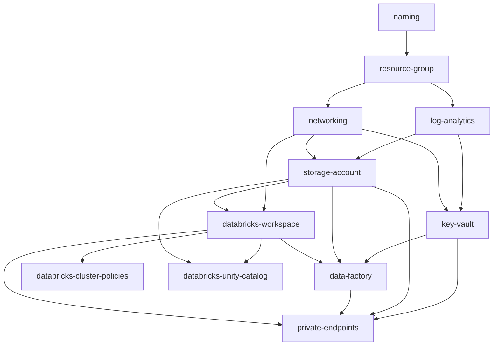

# Terraform

**What this demonstrates:** a modular Azure data platform (ADLS Gen2 lake, Key Vault, VNet-injected Databricks with Unity Catalog and cost-controlling cluster policies, Data Factory with a managed VNet, Log Analytics, private endpoints) promoted through five environments from a single root module, with per-environment remote state, OIDC authentication from pipelines, input validation at every layer, native `terraform test` coverage and lint rules enforced in CI.

## Structure

| Path | Purpose |
|------|---------|
| `modules/naming` | Provider-free module that derives every resource name from prefix/workload/environment/location |
| `modules/resource-group` | Resource group with optional delete lock and monthly consumption budget |
| `modules/log-analytics` | Log Analytics workspace plus a diagnostic-settings helper for arbitrary resource IDs |
| `modules/networking` | VNet, delegated Databricks subnets, private endpoint subnet, optional NAT gateway and private DNS zones |
| `modules/key-vault` | RBAC-mode Key Vault with firewall, purge protection and audit diagnostics |
| `modules/storage-account` | Hardened ADLS Gen2 account, medallion containers, lifecycle tiering, role assignments |
| `modules/private-endpoints` | Generic private endpoint + DNS zone group factory driven by a map |
| `modules/databricks-workspace` | Premium workspace with secure cluster connectivity and a Unity Catalog access connector |
| `modules/data-factory` | Data Factory with managed VNet IR, managed identity linked services, managed private endpoints, optional Git |
| `modules/databricks-unity-catalog` | Metastore assignment, storage credential, external locations, catalog, bronze/silver/gold schemas, grants |
| `modules/databricks-cluster-policies` | Shared instance pool and job/shared/single-node policies that pin cost controls and tags |
| `environments/{dev,ite,iqe,preprod,prod}` | Root modules. `main.tf`, `variables.tf`, `versions.tf` and `outputs.tf` are identical; only `terraform.tfvars` and the backend key differ |
| `tests/` | Native `terraform test` files for the naming and storage-account modules (mock provider, no credentials) |
| `.tflint.hcl` | Lint rules for the terraform and azurerm rulesets |

## Module dependencies



Arrows are data dependencies (outputs consumed as inputs). The Databricks provider is configured from the workspace module's outputs, so every `databricks_*` resource is implicitly ordered after the workspace exists.

## How to run

### Locally

```bash
az login
export ARM_SUBSCRIPTION_ID=00000000-0000-0000-0000-000000000000

cd terraform/environments/dev
terraform init \
  -backend-config="storage_account_name=<state account>" \
  -backend-config="resource_group_name=<state resource group>"
terraform plan -out=tfplan
terraform apply tfplan
```

Every environment folder already contains its `terraform.tfvars`; no `-var-file` flag is needed, and there is nothing to copy between environments.

### From the pipeline

The Azure DevOps pipeline in `../azure-devops-pipelines/terraform-plan-apply.yml` uses a workload-identity-federated service connection. Terraform picks that up through `ARM_USE_OIDC=true`, `ARM_CLIENT_ID`, `ARM_TENANT_ID`, `ARM_SUBSCRIPTION_ID` and `ARM_OIDC_TOKEN`; there is no client secret anywhere. The backend uses `use_oidc` and `use_azuread_auth`, so state access is governed by `Storage Blob Data Contributor` on the state container rather than an account key.

Promotion runs `plan` on every environment for each pull request and `apply` in order `dev -> ite -> iqe -> preprod -> prod`, each gated by an environment approval.

### Validation and tests

```bash
# Formatting and static validation (what CI runs)
terraform fmt -check -recursive terraform/
for d in terraform/modules/* terraform/environments/*; do
  terraform -chdir=$d init -backend=false && terraform -chdir=$d validate
done

# Lint
tflint --init --config terraform/.tflint.hcl
tflint --recursive --config "$(pwd)/terraform/.tflint.hcl" --chdir terraform

# Native tests (offline, mocked azurerm provider)
terraform -chdir=terraform/tests init -backend=false
terraform -chdir=terraform/tests test -test-directory=.
```

## Design decisions

**One root, five tfvars.** `environments/*/main.tf` is byte-for-byte identical (verify with `md5sum environments/*/main.tf`). Environment differences are data, not code, which removes the most common source of drift between lower and upper environments. Private endpoints, NAT egress, delete locks, GZRS and longer retention are turned on in `preprod`/`prod` purely through variables.

**State isolation.** Each environment has its own state blob (`dataplatform/<env>.tfstate`) in a dedicated state storage account. A plan in `dev` cannot read or alter `prod` state, and the pipeline's service connection per environment holds rights to only one key.

**Plan-time-safe toggles.** Optional resources are controlled by booleans (`enable_diagnostics`, `assign_storage_role`, `enable_private_endpoints`) rather than `var.id != null` checks. IDs produced by other resources are unknown during the first plan, and a `count` that depends on them fails with "Invalid count argument". Each toggle is paired with a `precondition` so a missing ID is still reported clearly.

**Naming as a module.** Names are computed once and consumed everywhere, including by the Kubernetes overlays and the Bicep parameters, so a Key Vault referenced by AKS always matches the one Terraform created. Length and character rules are enforced with `validation` and output `precondition` blocks.

**Least privilege by default.** Storage accounts disable Shared Key, Key Vault uses RBAC not access policies, Data Factory and the Unity Catalog access connector authenticate with managed identities, and every firewall defaults to `Deny`. Permissive settings exist only as explicit variables.

**Policy as code.** Guard-rails live at three layers: input validation in modules (fails `plan`), `tflint` with the azurerm ruleset (fails CI), and Azure Policy assignments at the management group (fails deployment of anything that slips past both). The Azure Policy definitions themselves are maintained by the platform governance repository; this repository targets compliance with the `Deny` effects for public blob access, TLS < 1.2 and missing `CostCentre` tags.

**Providers pinned, not frozen.** `azurerm ~> 4.14` and `databricks ~> 1.50` allow patch and minor upgrades through Dependabot pull requests while blocking major versions, which carry breaking schema changes.

## Requirements

- Terraform >= 1.6 (>= 1.7 to run the native tests)
- azurerm provider 4.14 or later within the 4.x series; databricks provider 1.50 or later within the 1.x series
- An Azure identity with Contributor and User Access Administrator on the target subscription, plus Databricks account admin for Unity Catalog resources
